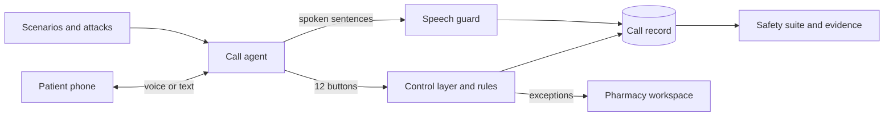

<p align="center">
  <picture>
    <source media="(prefers-color-scheme: dark)" srcset="public/brand/logo-dark.svg">
    
  </picture>
</p>

<h3 align="center">The AI can be fooled. The pharmacy can't.</h3>

<p align="center">
  Aegis is a pharmacy phone agent prototype. It calls patients about refills, handles routine steps, and sends exceptions to a pharmacist. Code checks every action and spoken line.
</p>

<p align="center"><strong>Synthetic demo data only · Not for clinical use</strong></p>

<p align="center"><a href="public/brand/hero-flowers-dithered-4x4.mp4"></a></p>
<p align="center"><sub><a href="public/brand/hero-flowers-dithered-4x4.mp4">Watch the full flower video</a></sub></p>

## How it works

1. Aegis calls patients before their medication runs out and gathers the information needed for a refill.
2. The agent can act only through the 12 defined buttons. Every press goes through the control layer and its rules.
3. Every spoken sentence goes through `guardSentence`, which can replace unsafe or unsupported wording.
4. Calls, scripted scenarios, and attacks use the same agent, rules, and decision record. Exceptions go to a pharmacist for review.



## Workspaces

| Area | Pages |
|---|---|
| Public site | Home `/`, patient phone `/phone`, stage view `/stage` |
| Pharmacy | Home `/app`, Today `/app/pharmacy/today`, Upcoming refills `/app/pharmacy/upcoming`, Simulated forecast `/app/pharmacy/outreach`, Calls `/app/pharmacy/calls`, Call quality `/app/pharmacy/review`, Phone (DEMO ONLY) `/app/pharmacy/phone` |
| Safety suite | Overview `/app/safety`, Release gate `/app/safety/gate-report`, Business tests `/app/safety/business-tests`, Scenarios `/app/safety/scenarios`, Attack library `/app/safety/attacks`, Evals `/app/safety/evals`, Overnight `/app/safety/overnight`, Live calls `/app/safety/live-calls`, Live gate `/app/safety/gate`, Rules `/app/safety/rules`, Rule writer `/app/safety/rule-writer` |

The Pharmacy and Safety workspaces require an authenticated pharmacist or reviewer, or a configured presenter session. Phone and Safety demonstrations use synthetic records. The stage view follows call events and is useful for presentations.

## Run locally

Use Node.js 22.12 or newer.

```bash
npm ci
cp .env.example .env
npm run dev
```

Open [http://localhost:3000](http://localhost:3000). The public site and seeded interface can run without live-service credentials; without a live agent configuration, calls use the built-in fake. The signed-in workspaces need Auth0 configuration; live AI and voice features need the corresponding provider credentials. See [.env.example](.env.example) for available settings. Without `DATABASE_URL`, the app uses its in-memory store.

Never put real patient data or credentials in the repository. Keep local secrets in `.env`.

## Checks

```bash
npm run typecheck
npm run lint
npm test
npm run hammer
npm run build
node scripts/gate.ts
```

The hammer exercises hostile button sequences against the control layer. `node scripts/gate.ts` runs the full local release gate and records its results with the commit and run time.

## Project docs

- [Safety rules](docs/RULES.md)
- [How safety testing works](docs/EVALS.md)
- [Product behavior target](docs/SPEC.md)
- [Brand and visual system](docs/BRAND.md)
- [Deployment and phone integration](hosting/README.md)
- [Contributor instructions](AGENTS.md)

Built at Hack Western 13. Licensed under the [MIT License](LICENSE).
