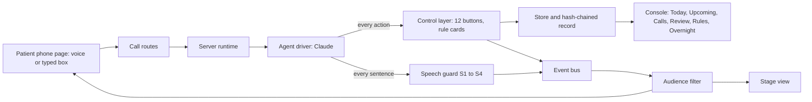

# What is built now

This page describes the code on `main` as of Saturday 21 November 2026, early afternoon (Eastern), after the merge of every ready branch. It replaces Andrew's 07:05 snapshot, which was accurate then. The product goal is in [SPEC.md](SPEC.md); ownership and interfaces are in [DESIGN.md](DESIGN.md). For live state, use [STATUS.md](STATUS.md) and the [agent channel](https://github.com/nishantshah0/namereserve/issues/1).

## Current path

## Which agent runs a call

`app/api/_lib/runtime.ts` (`describeAgent`) picks, in order:

1. `ANTHROPIC_API_KEY` set: Role 1's driver on the Messages API, model `claude-sonnet-5-5`.
2. `LIVE_AGENT=1`: the same driver on the Claude Agent SDK, model from `AGENT_SDK_MODEL`, Haiku 5.5 by default.
3. Neither: the contract's fake driver, which answers every line "One moment." Never use it for a demo or a result.

All three go through the same control layer, speech guard and record.

## Built on `main`

| Area | What's there |
|---|---|
| The lock | Contract and fakes, control layer (fails closed: invalid outcomes and missing card fields refuse), speech guard, safety check, hammers |
| Store | In-memory store, and the Postgres store on Tiger Data when `DATABASE_URL` is set |
| Calls | Inbound and outbound calls, side-effect question and follow-up, phone pairing (only a paired phone can answer), the phone page |
| Voice | ElevenLabs Flash through `POST /api/call/:id/speak` (the key stays on the server), Chrome's voice as the fallback |
| Events | Audience-filtered stream. Verification codes are never on it: `broadcastCodes` defaults to `false`, and the phone reads its code from its own route |
| Console | Today, Upcoming, Calls, Review, Rules (read only) and Overnight tabs, Auth0 sign-in |
| Red team | Scenarios, scenario runner, hijack agent and batch, hijack screen on `/stage` |
| Hosting | Vultr and Caddy deploy kit in `hosting/`. Not yet deployed |

## Still open

- Hosting: run `hosting/README.md` with the account codes (task 2.6).
- A saved run of the scenarios against the live agent, in `results/`.
- `docs/DEMO.md`: 3 clean passes in a row with the live agent.
- Michael's `lib/voice/elevenlabs.ts` (Trail #49) is merged but not wired; the phone uses the speak route above.

## Checks and results

The release gate runs typecheck, lint, tests, hammers and build on pull requests and pushes to `main`. The saved [hammer result](../results/hammer-latest.json) is the only source for hammer numbers.
