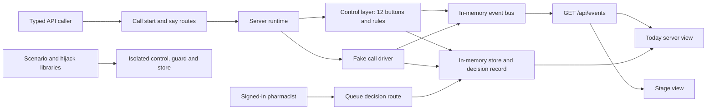

# What is built now

This page describes the code on `main` as checked on 21 November 2026. The product goal is in [SPEC.md](SPEC.md); ownership and interfaces are in [DESIGN.md](DESIGN.md). Work on other branches is not counted as merged.

## Current path

The call routes start calls through the real control layer, but `app/api/_lib/runtime.ts` still uses `createFakeDriver` for caller turns. That fake says “One moment.” The real Claude driver exists in `lib/agent/driver.ts`; it is not wired into the API yet. The scenario runner and hijack batch run as library code with isolated state. Their API routes still return 501.

The Today page reads the store on the server and uses events to refresh. The Stage page reads events. The event bus is separate from the hash-chained decision record; an event is not necessarily a record entry.

## Built and pending

| Built on `main` | Pending on `main` |
|---|---|
| Shared contract and fakes; control layer; speech guard; safety check; in-memory store and seed | Postgres store and hosted deployment |
| Typed Claude driver and tests in `lib/agent/` | Wiring that driver into the live API; patient phone page and voice |
| Call, clock, reset, daily check, queue decision and event routes; Auth0 check for pharmacist decisions | Audience filtering for the event stream; several API routes listed below |
| Today and Stage pages; ten scenario files; runner and hijack library | Review, Rules and Overnight pages; live scenario route and scoreboard |
| Hammer test and saved result in `results/hammer-latest.json` | Adaptive attacker, overnight fix loop and rule writer |

The following routes exist but return 501: `/api/arena/run`, `/api/arena/hijack`, `/api/calls/:id/record`, `/api/calls/:id/report`, `/api/gate/latest`, `/api/rules/draft`, and `/api/rules/:id/approve`.

## Known gap under review

`GET /api/events` currently has no audience check. The control layer defaults to putting verification digits in a `phone` event, and the API runtime has not turned that off. Role 2 has a stream audience fix under review; until it merges, do not treat the stream as private or use it with real patient data. The repo uses made-up patients only.

## Checks and results

The Release gate runs on pull requests and pushes to `main`: typecheck, lint, tests, hammer, and build. `npm run hammer` exists. The saved [hammer result](../results/hammer-latest.json) records 50,518 exhaustive sequences, 10,000 seeded random sequences, and 0 broken rules at 11:14 UTC on 21 November 2026. These counts describe that run, not every possible call.

Use [STATUS.md](STATUS.md) and the [agent channel](https://github.com/nishantshah0/namereserve/issues/1) for active branches and review state.
